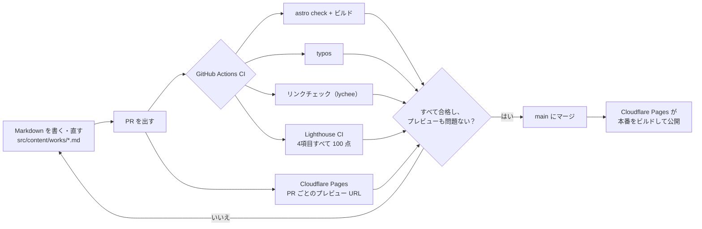

# michixsa

小さな Web 制作チーム **michixsa** のサイトです。LP や小規模サイトの制作、ドメインと公開の設定、インフラ・自動化の相談、公開後の保守・運用を受けます。

公開予定のドメインは <https://michixsa.com> です。ホスティングは Cloudflare Pages のままです。ドメインの接続と本番の切り替えは、オーナーが行います。

サイトは [Astro](https://astro.build/) で作った静的サイトです。制作サンプルは Markdown で書き、変更はすべて PR を通します。CI で型チェック・ビルド・誤字チェック・リンクチェック・Lighthouse による採点に合格するまで、本番には反映しません。

## 変更が公開されるまでの流れ



1. **書く**：制作サンプルは1件ごとに `src/content/works/` の Markdown ファイルで書きます。先頭の項目（frontmatter）は zod のスキーマ（`src/content.config.ts`）で検証します。タイトル・期間・担当・使用技術・`kind` のどれかが欠けているとビルドが失敗するので、書きかけのページが公開されることはありません。
2. **PR を出す**：`main` に直接反映することはありません。
3. **チェックとプレビュー**：CI が下のチェックを実行し、同じコミットについて Cloudflare Pages がプレビュー URL を作ります。公開前にスマートフォンで見た目を確認できます。
4. **マージ**：`main` にマージすると、Cloudflare Pages で本番への公開が始まります。

## 品質チェック

| チェック | ツール | 失敗する条件 |
| --- | --- | --- |
| 型とビルド | `astro check`、`astro build` | 型エラーがある、または frontmatter がスキーマに合わない |
| 誤字 | [typos](https://github.com/crate-ci/typos) | コードやドキュメントに既知の綴り間違いがある |
| リンク | [lychee](https://github.com/lycheeverse/lychee) | サイト内・外部のリンクが1つでも切れている |
| Lighthouse | [Lighthouse CI](https://github.com/GoogleChrome/lighthouse-ci) | パフォーマンス・アクセシビリティ・ベストプラクティス・SEO のどれかが 100 点未満（モバイル） |

架空のサンプル LP には、検索結果に出ないよう `noindex` を付けています。Lighthouse の SEO 項目は `noindex` を減点するため、LP の計測（`lighthouserc.lp.json`）ではその1項目（`is-crawlable`）だけを対象から外しています。それ以外の項目はすべて合格が必要です。

## 構成

```
src/
├─ pages/
│  ├─ index.astro            # トップページ
│  ├─ works/                 # サンプル
│  ├─ pricing.astro          # 料金と取引条件
│  ├─ partners.astro         # 同業者さまへ
│  ├─ about.astro            # チーム（個人の紹介は載せない）
│  ├─ faq.astro              # よくある質問
│  ├─ contact.astro          # メール（info@michixsa.com）
│  ├─ privacy.astro
│  ├─ demo/clinic-admin/     # 架空の予約管理画面
│  └─ lp/<name>/             # 独立したサンプル LP
├─ content/works/*.md
├─ layouts/BaseLayout.astro
├─ data/site.ts
├─ data/offer.ts
└─ content.config.ts
```

トップページの並びは、最初の画面、できること、強み、サンプル、料金の目安、保守、進め方、同業者さまへ、チーム、よくある質問、お問い合わせです。

掲載するものにはすべて `kind`（`client`・`employment`・`personal`・`sample`）があります。実在の実績には `status`（`active`・`completed`）も必須で、カードには「稼働中」「完了」「架空のサンプル」のバッジが自動で付きます。AI で生成した画像を使う作例は `aiImages: true` とし、「AI生成画像」も同じ仕組みで出します。架空のサンプルを受託実績と取り違えられないようにしています。

会社員時代のインフラ業務は、制作実績としては出していません。チームのページに、個人名・勤務先・数値を出さない短い説明だけを残しています。

## 料金

金額は `src/data/offer.ts` にまとめています。ページでは「目安（税込）」と、その金額からという意味の「〜」を付けて表示します。金額は勝手に変えないでください。

## まだ決まっていないこと

サイト上の【要確認】は、次の2つです。

- お問い合わせの窓口（どの手段で連絡を受けるか）
- 遠方からのご依頼と、対面での打ち合わせ

## ローカルでの開発

[Bun](https://bun.sh/) が必要です。`typos` と `lychee` は単体のコマンドなので、好きな方法（たとえば Nix）で入れてください。

```sh
bun install
bun run dev          # http://localhost:4321/
bun run verify       # 型チェック・ビルド・typos・リンク・Lighthouse をまとめて実行
```

| スクリプト | 内容 |
| --- | --- |
| `bun run dev` | 開発サーバーを起動 |
| `bun run check` | `astro check`（型と診断） |
| `bun run build` | 静的サイトを `dist/` に生成 |
| `bun run preview` | `dist/` をローカルで表示 |
| `bun run lint:typos` | 誤字チェック |
| `bun run lint:links` | `dist/` 内のすべてのリンクをチェック |
| `bun run lighthouse` | `dist/` に対して Lighthouse CI を実行 |

## ホスティング

Cloudflare Pages の GitHub 連携で、このリポジトリとつないでいます。ビルドコマンドは `bun run build`、出力ディレクトリは `dist` です。レスポンスヘッダーは `public/_headers` で設定しており、`/lp/*` には `X-Robots-Tag: noindex` を付けています。
